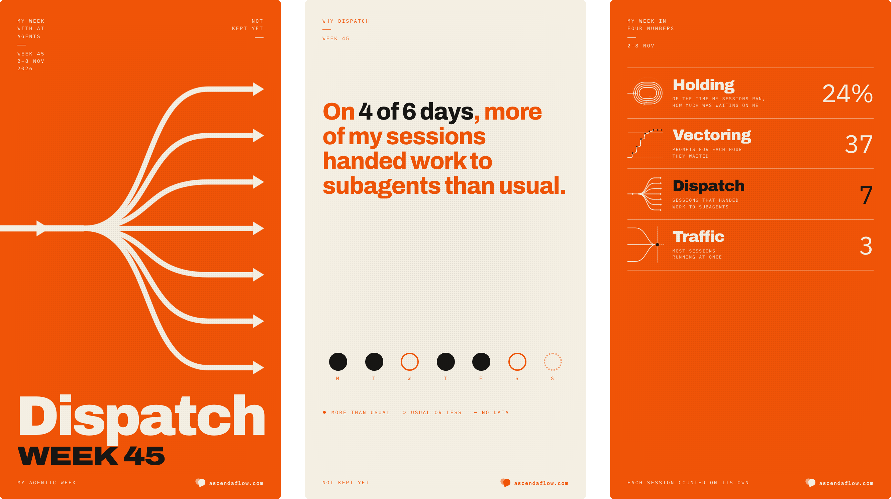
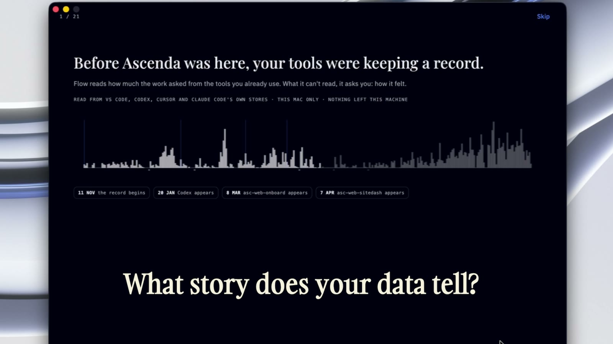
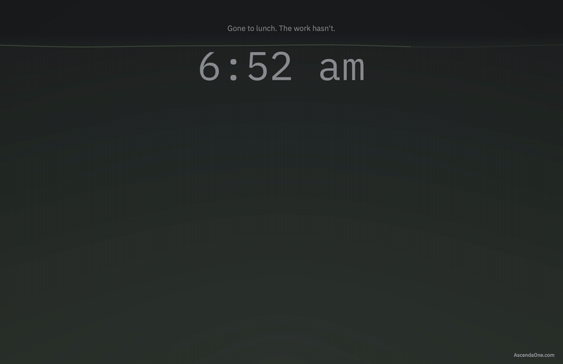

# ai-engineer-tools

**Open-source collectors that record what your AI coding agents do:** which
tools they call, when they stop and wait for you, how each turn ended. Claude
Code, Codex, Cursor, Gemini CLI, Windsurf and Copilot CLI all report into one
event format,
and an extension covers VS Code and Cursor. Prompts, responses and source code
are never recorded. No account needed.

```text
$ node examples/local-event-reader/read-events.mjs --follow
Watching ~/.ascenda/events.jsonl. Ctrl-C to stop.
07:29:39 AM  Claude Code  session.started
07:29:41 AM  Claude Code  prompt.submitted
07:29:44 AM  Claude Code  tool.started Read
07:29:45 AM  Claude Code  tool.completed Read
07:29:47 AM  Codex        prompt.submitted
07:29:49 AM  Claude Code  tool.started Edit
07:29:50 AM  Claude Code  tool.completed Edit
07:29:52 AM  Codex        tool.started local_shell
07:29:53 AM  Claude Code  tool.started Bash
07:29:56 AM  Codex        tool.failed local_shell (failure)
07:29:58 AM  Claude Code  tool.failed Bash (failure)
07:30:00 AM  Claude Code  agent.waiting
07:30:02 AM  Claude Code  turn.completed
```

A Claude Code session and a Codex session side by side, read by
[a small script](./examples/local-event-reader/) with no dependencies.

## Try it

Install the hooks for the agent you use. This one is Claude Code:

```bash
npx -y @ascenda-one/claude-code-hooks setup --no-pair
```

`--no-pair` keeps everything on your machine. Restart the agent, use it for a
minute, then watch the events arrive:

```bash
node examples/local-event-reader/read-events.mjs --follow
```

| Agent | Setup command |
| --- | --- |
| Claude Code | `npx -y @ascenda-one/claude-code-hooks setup --no-pair` |
| Codex CLI | `npx -y @ascenda-one/codex-hooks setup --no-pair` |
| Cursor (agent) | `npx -y @ascenda-one/cursor-hooks setup --no-pair` |
| Windsurf | `npx -y @ascenda-one/windsurf-hooks setup --no-pair` |
| Gemini CLI | `npx -y @ascenda-one/gemini-hooks setup --no-pair` |
| Copilot CLI | `npx -y @ascenda-one/copilot-hooks setup --no-pair` |

If something doesn't show up, run `~/.ascenda/bin/ascenda-claude-hook doctor`
(or the same for your agent). It says what's wrong and how to fix it.
VS Code, the Claude Code plugin, upgrades and offline installs are in the
[install guide](./docs/INSTALL.md).

## What it records

Counts and classifications, never content.

| Recorded | Never recorded |
| --- | --- |
| Which agent, which session, which tool | Prompt and response text |
| Whether a tool call succeeded or failed | File contents and command output |
| When an agent is waiting on you | Folder names (hashed with a salt that never leaves your machine) |
| Context compaction, subagents, test and build runs | |
| A digest of a GitHub repository and branch, unsalted, so a session can be matched to its pull request | |

Unpaired, the events go to a file on your machine and nowhere else. The
[event format](./docs/EVENT_FORMAT.md) is open and versioned, and
[privacy](./docs/PRIVACY.md) says exactly what each package sends and what the
numbers can and can't tell you.

## Build on it

Feed your own dashboards, internal tools or research. Skip the part where
every agent reports differently and changes its hooks every few weeks.

- **Read the events.** [`agent-event/v0`](./packages/agent-events/) has the
  schema, types and a reader. [Collecting from a team](./docs/TEAM_COLLECTION.md)
  gets every engineer's events into one place.
- **Add an agent.** Each collector is a thin adapter over a shared runtime.
  [CONTRIBUTING.md](./CONTRIBUTING.md) walks through it, with no backend
  needed to test.
- **Tell us what breaks.** The [issue forms](https://github.com/ascendaone-com/ai-engineer-tools/issues/new/choose)
  take compatibility reports and proposals for new integrations.

The format is v0 and experimental. What you tell us is missing decides v1.
Forks and commercial products are welcome under [Apache-2.0](./LICENSE).

## Beyond the collectors

The collectors are the open part. Ascenda builds three free things on the
same events.

**The weekly poster.** Pair an agent with
[me.ascendaflow.com](https://me.ascendaflow.com/?source=github) and a poster of
your week with AI agents arrives every Monday: the word that sums the week up,
and the counts behind it. It runs in the browser.
[Play with an example week](https://me.ascendaflow.com/try?source=github),
with nothing to install and no account.

<a href="https://me.ascendaflow.com/try?source=github"></a>

**Ascenda Flow** is a Mac app that shows how you work with your agents: how
many you run at once, when your best work happens, what gets in the way. It
starts from the history Claude Code, Cursor and Codex already keep on your
Mac, and draws your boarding pass from it, one bar for each day you worked.
[Download Flow](https://www.ascendaflow.com/download?source=github)

<a href="https://qhgnbjww4xwimiev.public.blob.vercel-storage.com/videos/onboarding-demo-2.mp4"></a>

<sub>[Watch the four-minute walkthrough](https://qhgnbjww4xwimiev.public.blob.vercel-storage.com/videos/onboarding-demo-2.mp4).
Flow is closed source and isn't part of this repo.</sub>

**Waterline** is a screen saver for macOS that turns agent activity into a
water level. It runs on your Mac with no account.
[See Waterline](https://www.ascendaflow.com/waterline?source=github)



**The Founding Benchmark** studies how small AI-native teams work with
agents: concurrency, who carries the review load, steering and rework. We're
inviting 200 teams of about 2 to 15 engineers. It's free, and each engineer
decides whether to take part.
[Apply with your team](https://www.ascendaflow.com/benchmark?source=github)

## Documentation

| | |
| --- | --- |
| [Install and upgrade](./docs/INSTALL.md) | Every agent, VS Code, the Claude Code plugin, offline installs |
| [Pairing](./docs/PAIRING.md) | Linking an install to an Ascenda account |
| [The event format](./docs/EVENT_FORMAT.md) | The schema, and what each agent can report |
| [Privacy and what this measures](./docs/PRIVACY.md) | What's sent, and what the numbers do and don't show |
| [Packages](./docs/PACKAGES.md) | Every package in the repo and what it does |
| [Developing](./docs/DEVELOPING.md), [TESTING.md](./TESTING.md) | Build from source, run with no backend |
| [Getting help](./SUPPORT.md) | Bugs, compatibility reports, security |

Wire contract: [Tool Pairing API Reference](./api-docs/TOOL_PAIRING_API_REFERENCE.md).
