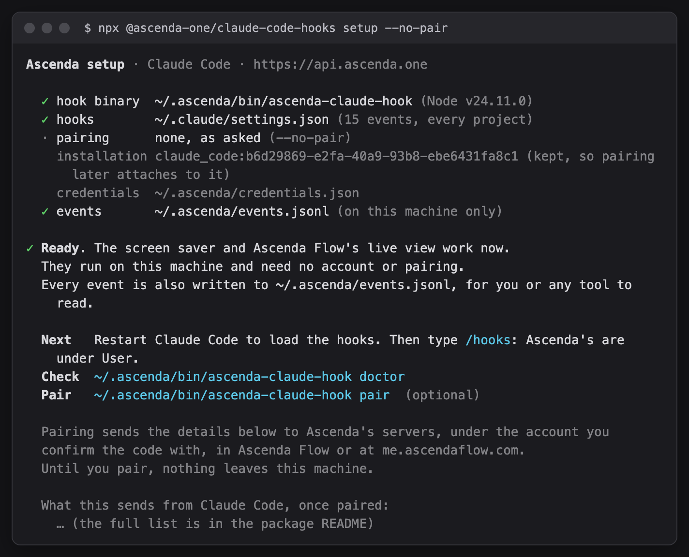
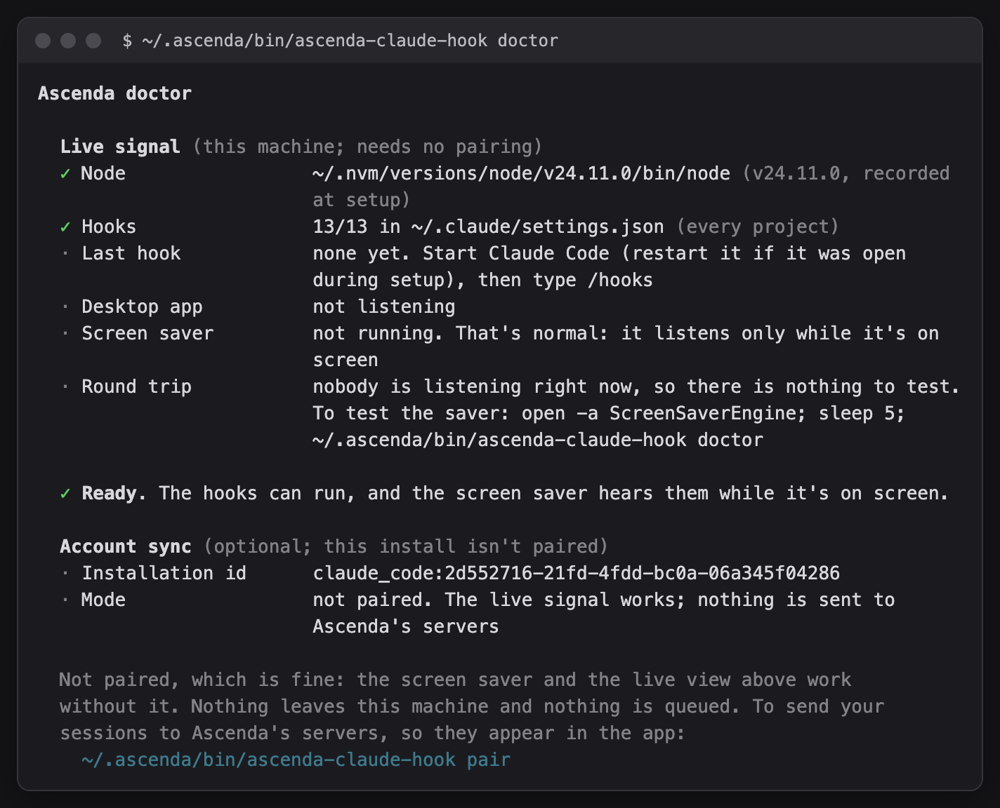
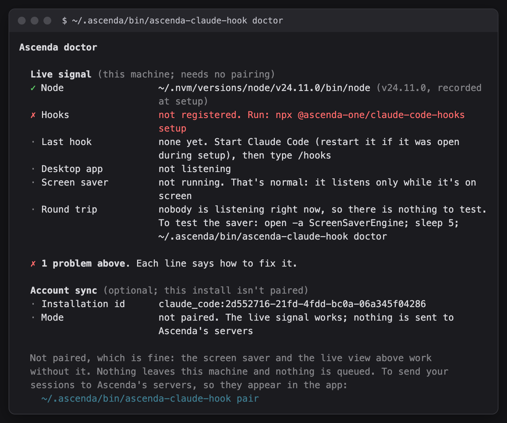
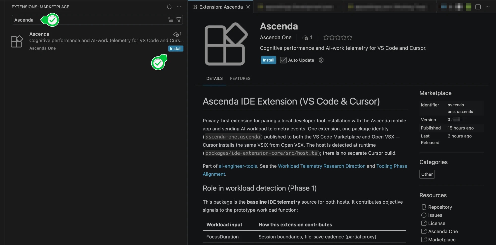
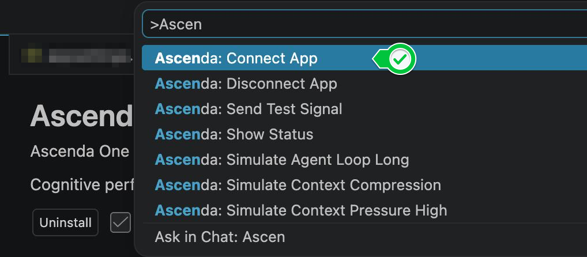

# Install and upgrade

Every way to install the collectors, check they work, keep them current, and install from a release when you can't reach a registry.

## Install

Pick the tools you use. Each works alone, and each has its own pairing.

| Agent | Command | Hooks registered in |
| --- | --- | --- |
| Claude Code | `npx -y @ascenda-one/claude-code-hooks setup` | `~/.claude/settings.json` |
| Codex CLI | `npx -y @ascenda-one/codex-hooks setup` | `~/.codex/hooks.json` |
| Cursor (agent) | `npx -y @ascenda-one/cursor-hooks setup` | `~/.cursor/hooks.json` |
| Windsurf | `npx -y @ascenda-one/windsurf-hooks setup` | `~/.codeium/windsurf/hooks.json` |
| Gemini CLI | `npx -y @ascenda-one/gemini-hooks setup` | `~/.gemini/settings.json` |
| Copilot CLI | `npx -y @ascenda-one/copilot-hooks setup` | `~/.copilot/hooks/ascenda.json` |

If you've set `CLAUDE_CONFIG_DIR`, `CODEX_HOME` or `COPILOT_HOME`, setup writes there.

Add `--no-pair` to install without an account. `setup` then installs the hooks
and stops. The live signal and the local event log work, and nothing is sent.



What `setup` does, for every agent:

- **Registers the hooks for every project.** `--scope project` limits them to
  the current folder instead. Re-running `setup` moves an older install from
  the other place, so each event runs once.
- **Installs a launcher that finds Node.** Each hook runs
  `~/.ascenda/bin/ascenda-<agent>-hook`, a small shell script that uses the
  Node 20+ that ran `setup` and finds another if that one goes (Homebrew, nvm,
  fnm, volta, asdf, mise). Hooks keep working when the agent starts from the
  Dock or an IDE without your shell's PATH. On Windows the hook runs the Node
  that ran `setup` directly.
- **Pairs,** unless you passed `--no-pair`: it prints a 6-digit code. Confirm
  it in the Flow app under **Connections → Ingest telemetry**, or at
  [me.ascendaflow.com/connect](https://me.ascendaflow.com/connect?source=github)
  for the weekly poster.

Nothing goes in your shell profile. Then restart the agent:

- **Claude Code:** type `/hooks`. The Ascenda hooks are listed under **User**.
- **Codex:** open `/hooks` and trust the Ascenda hooks. Codex doesn't run a
  hook until you do.

### Check it works

```bash
~/.ascenda/bin/ascenda-claude-hook doctor     # or ascenda-codex-hook, -cursor-, -gemini-, -windsurf-, -copilot-
```

`doctor` checks the local half first, which needs no pairing. Can the hooks
start, are they registered where the agent loads them, has the agent run one
yet, and is anything listening for the live signal. When the screen saver is
running it pings it and waits for the answer. Every line says how to fix
what it finds.





`status` is the short version, and exits non-zero when something is missing,
so it can gate a CI step. `uninstall` removes the hooks, the launcher and the
pairing.

### Claude Code: the plugin, or `setup`

The Claude Code plugin installs the hooks together with the work-signals
skill and the MCP server:

```bash
claude plugin marketplace add ascendaone-com/ai-engineer-tools
claude plugin install ascenda@ascenda-one
```

Its hooks run through `npx`, so they need Node on the PATH Claude Code was
started with, and they don't get the launcher. Use the plugin or `setup` for
the hooks, not both: with both, every event runs twice.

### VS Code and the Cursor editor

The editor extension records editor and terminal activity. It is one
extension for both editors.

1. Open the Extensions pane (**⇧⌘X**, or **Ctrl+Shift+X** on Windows and Linux).
2. Search **Ascenda** and click **Install**. The publisher is `ascenda-one`.

   

3. Open the Command Palette (**⇧⌘P** / **Ctrl+Shift+P**) and run
   **Ascenda: Connect App**.

   

From the command line instead:

```bash
code   --install-extension ascenda-one.ascenda   # VS Code
cursor --install-extension ascenda-one.ascenda   # Cursor
```

On macOS those commands aren't on PATH until you run **Shell Command: Install
'code' command in PATH** from the Command Palette.

## Upgrading

An install keeps the hooks it registered until `setup` runs again, so a
release that adds a hook reaches you on the next `setup`. The Flow app says so
in **Connections → Ingest telemetry** and names the command.

```bash
npx -y @ascenda-one/claude-code-hooks setup     # or codex-, cursor-, gemini-, windsurf-, copilot-hooks
```

`setup` is safe to re-run. It keeps your pairing, replaces its own entries,
and prints what it added. Restart the agent afterwards. A plugin install
upgrades with `claude plugin update ascenda@ascenda-one` instead.

A paired install checks for a newer release once a day. After it has sent
your events, the background sender fetches the release manifest from GitHub.
The request carries nothing about you. `status` prints what it found on its
`latest` line. In Claude Code, the first session after a release starts with
a one-line note naming the release and the command. Below the oldest
supported release, the note comes back every session until you update. A
plugin install runs its hooks through `npx`, which fetches new releases by
itself. Its note comes when a release adds hooks the plugin's `hooks.json`
doesn't register yet, and names `claude plugin update`. An unpaired install
never checks. To turn the check off, set
`ASCENDA_DISABLE_UPDATE_CHECK=true`.

## Install from a release (no registry)

For machines that can't reach the Marketplace or npm, or for anyone who wants
to check a checksum first. Every tagged release attaches each artifact and a
`manifest.json`; resolve downloads through the manifest rather than from
`main`. Requires **Node 20+**.

```bash
BASE=https://github.com/ascendaone-com/ai-engineer-tools/releases/latest/download
curl -fsSLO "$BASE/manifest.json"
cat manifest.json    # { version, minNode, artifacts: [{ name, url, sha256 }] }
```

**The editor extension.** One VSIX for both editors:

```bash
curl -fsSLO "$BASE/ascenda-<version>.vsix"
code   --install-extension ./ascenda-<version>.vsix   # VS Code
cursor --install-extension ./ascenda-<version>.vsix   # Cursor
```

Prefer the Marketplace or Open VSX when you can reach them; you get updates.

**The hooks.** Each is a self-contained ESM file with no dependencies.
Download it anywhere and run its `setup`, which installs the launcher and the
bundle in `~/.ascenda/bin`. No sudo, no `npm -g`, nothing to add to PATH:

```bash
curl -fsSLO "$BASE/ascenda-codex-hooks.mjs"
node ascenda-codex-hooks.mjs setup --no-pair
```

**Verify before you run.** Check the checksum against the manifest, and
optionally the build provenance:

```bash
shasum -a 256 ascenda-codex-hooks.mjs        # must match sha256 in manifest.json
gh attestation verify ascenda-codex-hooks.mjs --repo ascendaone-com/ai-engineer-tools
```

Releases are built only by [`.github/workflows/release.yml`](../.github/workflows/release.yml),
gated on `npm run verify`, and signed with keyless Sigstore build provenance.
