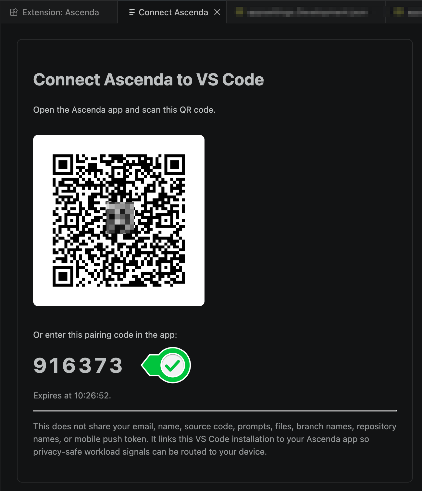

# Pairing

Pairing links one tool installation to your Ascenda account. Each tool pairs
on its own, and each pairing can be revoked on its own, in the Flow app or on
[me.ascendaflow.com/connect](https://me.ascendaflow.com/connect?source=github).
The code works in either place:

- **Ascenda Flow,** the Mac app, under **Connections → Ingest telemetry**.
- **[me.ascendaflow.com/connect](https://me.ascendaflow.com/connect?source=github),**
  if you signed up for the weekly poster and have no app.

**The editor extension** pairs with **Ascenda: Connect App**, which shows a QR
code and a six-digit code, good for a few minutes:

Scan the QR with your phone, or enter the code in Flow or on
me.ascendaflow.com/connect. The code carries no personal data.

The pairing request carries the tool's name (`Claude Code`, `VS Code`) and a
random installation id, nothing about the machine or the person. No hostname,
no username. The installation id is what tells two installs apart.

**The CLI agents** pair during `setup`, which prints a link to confirm in a
browser and the same kind of code, with both places it works. To
pair an install made with `--no-pair`, run `setup` again (or, for Claude Code,
`~/.ascenda/bin/ascenda-claude-hook pair`). It attaches to the installation
already on file, so the hooks you have keep their identity.

The editor's pairing can't be shared with the CLI agents: its token lives in
the editor's own secret storage, by design. Each CLI agent keeps its pairing
under its own key in `~/.ascenda/credentials.json`, so several agents on one
machine never borrow each other's identity. `ASCENDA_TOOL_INSTALLATION_ID`
overrides that for every agent at once; set it only if you mean that.

A `setup` whose pairing can't finish (the server unreachable, the code not
confirmed in time) still installs the hooks, and says plainly that it isn't
paired.
